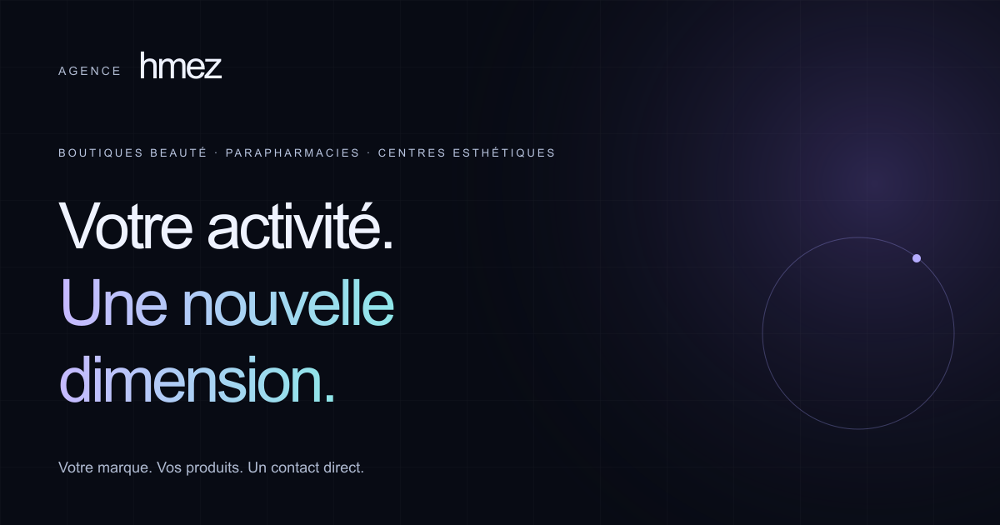

# Agence Hmez

A French-language agency website for selling web design to beauty shops, parapharmacies and aesthetic clinics in Tunisia, bundled with two working demo sites that prospects can click through.



## What it does

- **Agency site** (`/`, `/contact`, `/privacy`, `/terms`): the offer, process, FAQ and contact routes, with phone, WhatsApp and email links.
- **Avela Clinique** (`/demo`): a fictional aesthetic clinic with a treatment catalogue, per-treatment pages and a three-step consultation request that never leaves the browser.
- **Concept Beauté** (`/beautyshop/concept`): a fictional boutique catalogue with search, category filters, product dialogs and a pre-filled WhatsApp enquiry.
- **Reference preview** (`/beautyshop`): a screenshot of an existing external shop that loads a sandboxed iframe only after an explicit click.

Both demos are labelled as fictional in the UI, carry `noindex` metadata and headers, and are left out of the sitemap.

## Engineering highlights

- **Hardened enquiry endpoint.** `src/app/api/enquiry/route.ts` accepts only same-origin JSON, compares `Origin` with the public `Host` header (Next.js can normalise `request.url` to an internal hostname), and counts streamed bytes against a 12 KB cap instead of trusting `Content-Length`.
- **Idempotent delivery.** The form generates a UUID v4 request key that changes only when the content changes. The server claims that key in Redis with `SET NX` and a 24-hour expiry, stores an HMAC fingerprint of the payload, and passes the same key to Resend, so retries and overlapping invocations do not send twice. Reusing a key with different content returns 409.
- **Fails closed.** Without complete mail and rate-limit configuration the endpoint returns 503 rather than pretending to send. Local simulation is refused when `NODE_ENV` is `production`. Provider errors are neither logged nor returned to the visitor, and a Redis timeout rejects the request.
- **Dependency-injected service.** `processEnquiry` takes its rate limiter, claim store and mail sender as a `DeliveryDependencies` object, so validation, throttling, conflict and retry paths are unit-tested without network access.
- **Demo booking with a privacy test.** `BookingAdapter` defines the boundary for a future live integration; the demo adapter does no fetch, storage or logging. An end-to-end test types sentinel personal data through the flow and asserts that it never appears in a request, URL, console message, cookie or web storage.
- **Config-driven demos.** `src/config/clinic.ts` is a typed `ClinicConfig`: treatment slugs generate catalogue cards, static detail routes and booking options, and theme colours are injected as CSS variables.
- **Accessible motion.** Decorative effects respect `prefers-reduced-motion` (including changes while the page is open), expose a keyboard-accessible pause control, and all content renders before JavaScript runs.
- **Two-layer Cloudflare deployment.** The app is built for Workers with vinext. A small Pages gateway (`cloudflare/pages/public/_worker.js`) forwards to the Worker through a service binding and rewrites canonical, Open Graph, robots and sitemap URLs with `HTMLRewriter`.

## Tech stack

- Next.js 16 (App Router), React 19, TypeScript, Tailwind CSS 4
- Zod for shared client/server validation
- Resend for mail delivery, Upstash Redis and `@upstash/ratelimit` for throttling and deduplication
- vinext, Vite and Wrangler for the Cloudflare Workers build
- Vitest and Testing Library (24 unit and component tests)
- Playwright with axe-core across Chromium, Firefox and WebKit
- ESLint, Prettier, Lighthouse

## Project structure

```
src/app/(agency)/      agency pages, contact, draft privacy and terms
src/app/demo/          Avela clinic demo and treatment routes
src/app/beautyshop/    reference preview and Concept Beauté catalogue
src/app/api/enquiry/   same-origin JSON endpoint
src/components/        forms, catalogue, navigation, motion layer
src/config/            typed content for the agency, clinic and boutique
src/lib/               validation, enquiry service, provider wiring, metadata
cloudflare/pages/      Pages gateway in front of the Worker
scripts/               launch check, Lighthouse run, Pages wrapper
tests/unit/            Vitest suites
tests/e2e/             Playwright suite
docs/                  customization, launch checklist, asset provenance
```

## Getting started

Requires Node.js 22.12+, 24 or 26 (`.nvmrc` pins 24).

```sh
npm ci
cp .env.example .env.local
npm run dev
```

Open http://127.0.0.1:3000. With `MAIL_MODE=local` the enquiry form is simulated in development only and the UI says so.

```sh
npm run check                 # lint, typecheck, unit tests, production build
npx playwright install chromium firefox webkit
npm run test:e2e              # starts the production server unless one is running
npm run check:launch          # verifies production configuration before going public
npm run audit:performance     # Lighthouse against a running local production server
```

Cloudflare Workers build and local runtime:

```sh
npm run build:vinext
npm run start:vinext
```

`npm run deploy:vinext` and `npm run deploy:pages` publish to the Cloudflare account configured in `wrangler.jsonc` and `scripts/pages.mjs`; change the account and project names before using them.

Environment variables (see `.env.example`):

- `NEXT_PUBLIC_SITE_URL`, `PUBLIC_LAUNCH_READY`
- `MAIL_MODE`, `RESEND_API_KEY`, `RESEND_FROM_EMAIL`, `ENQUIRY_TO_EMAIL`
- `UPSTASH_REDIS_REST_URL`, `UPSTASH_REDIS_REST_TOKEN`, `RATE_LIMIT_SECRET`
- `CONTACT_DIRECT_ONLY` (Workers variable; shows direct contact links instead of the form)

## Security notes

Security headers and the Content Security Policy are set in `next.config.ts`. The CSP blocks external scripts and connections and allows a single external frame origin for the reference preview. `script-src` includes `'unsafe-inline'` because the pages are statically rendered; a nonce-based policy would require dynamic rendering.

Per-client rate limiting trusts only Vercel's forwarded-address header. On any other host, including the current Cloudflare deployment, all visitors share one conservative bucket until trusted proxy handling is added for that platform.

## Status

The owner's own product. The agency site is deployed at https://agence-hmez.pages.dev with `CONTACT_DIRECT_ONLY=true`, so visitors contact the agency by WhatsApp, phone or email. The enquiry form and its Resend and Upstash delivery path are implemented and covered by tests using mocks, but have not been run against live provider accounts.

Indexing is disabled (`PUBLIC_LAUNCH_READY=false`) and the privacy and terms pages are marked as drafts. Remaining launch items are tracked in `docs/LAUNCH_CHECKLIST.md`. Avela Clinique and Concept Beauté are fictional demos, not client projects. Stock photography sources and font licences are listed in `docs/ASSET_PROVENANCE.md`.

Built by [Hamza Dellai](https://github.com/devhmez).
